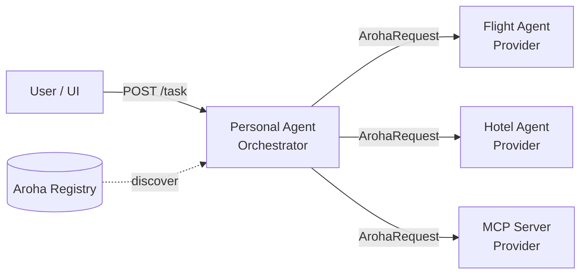
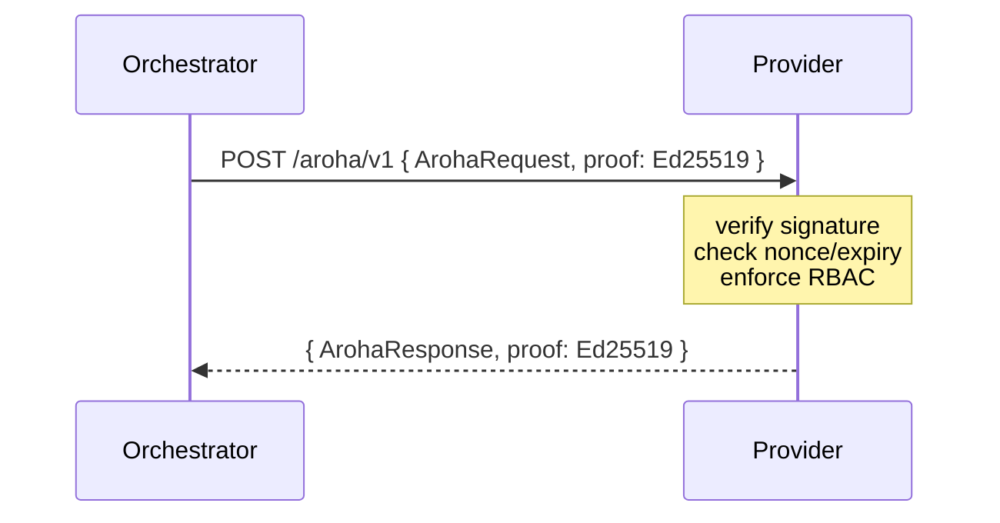
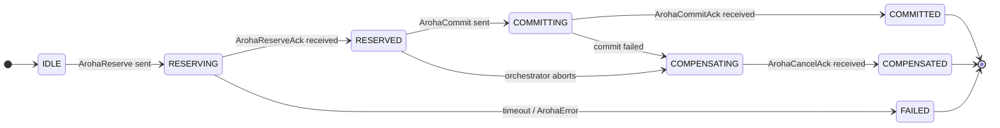
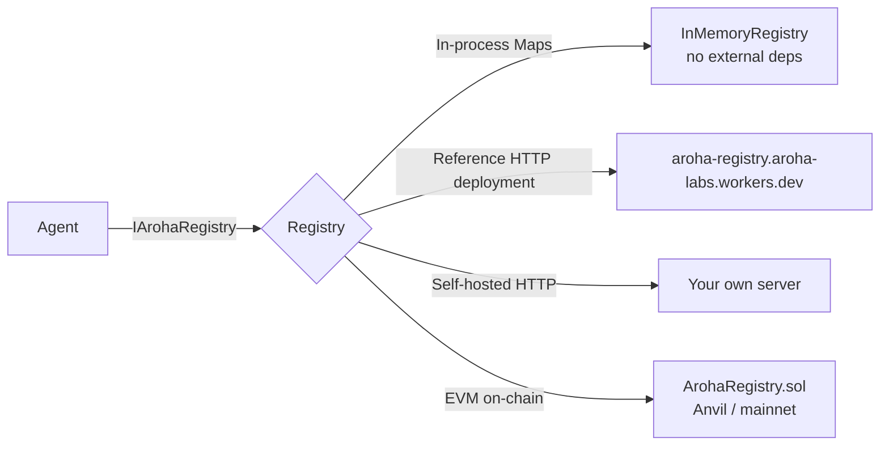
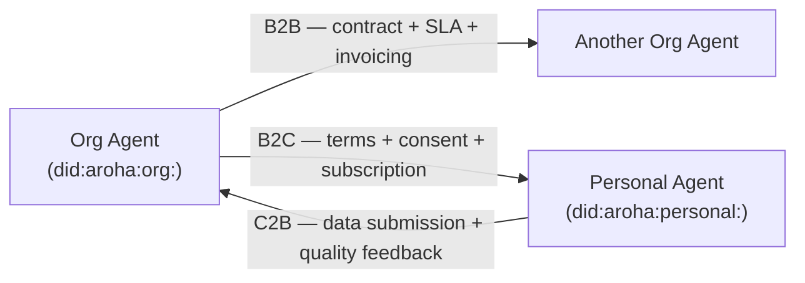

<!-- Copyright (c) 2026 Aroha Labs
     SPDX-License-Identifier: Apache-2.0 -->

# Architecture

> **Positioning note (2026-10-19).** This page describes the full layer stack, including the extensions. Aroha now describes itself as the protocol for **bounded, verifiable agent authority** — who is acting, what a person allowed, how to stop it, and what happened. Discovery, sagas, settlement and commerce remain available as optional extensions and are documented here as such. See [What Aroha is (and is not)](positioning.md). Since the specification revision of 2026-10-25, orchestration (sagas) and preference context are specified in the [extensions document](spec/extensions.md), not the core specification.

Aroha is a **four-layer protocol stack** (Layers 0–3) for agent-to-agent communication, with mandates defined in Layer 3 (spec §6.5–§6.9) and optional extensions for orchestration, preference context, settlement and commerce. Each layer is independently testable and replaceable.

## Design principle: kernel + extensions

The core protocol (Layers 0–3) covers exactly two things: **agent discoverability** and **agent verifiability**. This is the minimum surface needed to answer the question *"can I trust this agent and can I reach it?"*

Everything else — billing, B2B contracts, B2C subscriptions, C2B feedback, RBAC, escrow — is an extension mounted via middleware or injected into the saga engine. The kernel never imports the extensions.

```
┌──────────────────────────────────────────────────────────────────────┐
│  PROTOCOL EXTENSIONS (opt-in, never imported by kernel)              │
│                                                                       │
│  @aroha-sdk/credentials   RBAC middleware, human credential issuance       │
│  @aroha-sdk/settlement    Pluggable billing: NullSettlement → Escrow       │
│  @aroha-sdk/commerce      B2B · B2C · C2B commerce, audit, consent        │
└──────────────────────────────────────────────────────────────────────┘
                              ↑ mount via middleware / inject
┌─────────────────────────────────────────────┐
│  Extension — Preference Context (was L5)    │  budget, consent, satisfaction signals
├─────────────────────────────────────────────┤
│  Extension — Orchestration (was L4)         │  saga state machine (reserve/commit/cancel)
├─────────────────────────────────────────────┤
│  Layer 3 — Messaging                        │  signed JSON-LD envelopes, 19 message types, mandates
├─────────────────────────────────────────────┤
│  Layer 2 — Registry                         │  pluggable (HTTP baseline; optional EVM contract) + IPFS manifests
├─────────────────────────────────────────────┤
│  Layer 1 — Identity & Auth                  │  did:aroha DIDs, Ed25519, VCs
├─────────────────────────────────────────────┤
│  Layer 0 — Transport                        │  HTTPS, WebSocket, TLS 1.3+
└─────────────────────────────────────────────┘
```

This design is analogous to a Unix kernel + loadable modules — or to TCP/IP (which defines addressing and delivery) being composed with TLS (encryption) and HTTP (application protocol). W3C DID Core + DIDComm v2 follow the same separation.

---

## Agent roles

Aroha distinguishes two types of participant:



| Role | Responsibilities |
|------|----------------|
| **Orchestrator** | Decomposes user intents, discovers providers, drives sagas |
| **Provider** | Exposes one or more capabilities, participates in sagas |

An agent can be both — a provider to some orchestrators and an orchestrator to others.

---

## Message flow

Every exchange uses signed envelopes. Replay protection (nonce + expiry) is built in.



For transactional capabilities, the saga pattern adds three more exchanges:



---

## Component map

### Monorepo packages

```
Protocol Kernel
├── aroha-core/         Transport (ArohaServer, ArohaClient) + Identity + Messaging
└── aroha-registry/     EVM registry contract client + IPFS manifest + discovery

Protocol Extensions
├── aroha-credentials/  RBAC middleware + human credential issuance (ArohaMiddleware)
└── aroha-preferences/  PreferenceProfile + filtering + satisfaction signals

Published on npm; source not in this repository
├── aroha-settlement/   IArohaSettlement — 6 backends: Null · ApiKey · Quota · Escrow · Postgres · Stripe
├── aroha-commerce/     B2B agreements + SLA · B2C consent + subscriptions · C2B feedback + audit
├── aroha-orchestrator/ SagaEngine + HITL approval gate + AgentSelector + Negotiator
└── aroha-reputation/   Bayesian reputation engine

Protocol Bridges
├── aroha-a2a-bridge/       A2A ↔ Aroha message translation
├── aroha-mcp-bridge/       MCP tool ↔ Aroha capability translation
└── aroha-langchain-bridge/ LangChain / OpenAI function tools ↔ Aroha (duck-typed, no hard dep)

Enterprise Tooling
├── aroha-telemetry/    W3C Trace Context propagation — Datadog / Jaeger / Grafana Tempo
└── aroha-trusted-mesh/ VPC / mTLS bypass — skip Ed25519 verification on internal networks
```

### Smart contracts

Optional; not part of the core protocol (see [positioning](positioning.md)).

```
contracts/
├── ArohaRegistry.sol    Agent registration, capability indexing, staking
├── ArohaEscrow.sol      Atomic escrow per saga (open → split → release)
└── ArohaReputation.sol  EMA-based reputation scores recorded by the contract owner
```

Only the `ArohaReputation` owner (the deploying address) can call `recordOutcome`; the
escrow contract does not write scores. Ownership moves in two steps: the owner calls
`transferOwnership(newOwner)`, then `newOwner` calls `acceptOwnership()`.

---

## Discovery flow

How an orchestrator finds a provider for a given capability:

```mermaid
flowchart TD
    O[Orchestrator] -->|queryByCapability| R[(ArohaRegistry\non-chain / HTTP)]
    R -->|AgentRecord[]| O
    O -->|fetchManifest| IPFS[(IPFS)]
    IPFS -->|CapabilityManifest| O
    O -->|verify manifest signature| O
    O -->|ArohaRequest fan-out| P1[Provider A]
    O -->|ArohaRequest fan-out| P2[Provider B]
    P1 -->|ArohaResponse| O
    P2 -->|ArohaResponse| O
    O -->|score + select winner| O
    O -->|ArohaReserve| Winner[Winning Provider]
```

---

## Trust model

Aroha uses five trust levels:

| Level | Requirements | Permitted Operations |
|-------|-------------|---------------------|
| 0 | None | Read manifests, query registry |
| 1 | Registered with a Layer 2 registry (stake only where an optional blockchain registry requires one) | Search, negotiate |
| 2 | Verifiable Credential from trust anchor | Reserve (low-value) |
| 3 | Reputation ≥ 8000 | Reserve + commit (high-value) |
| 4 | Explicit user authorization | Full access + payments |

Signatures on every message prevent impersonation. Nonces prevent replay attacks.
RBAC enforced at the transport layer (before application code runs) prevents privilege escalation.

---

## Pluggable registry

Layer 2 is intentionally pluggable — four modes with the same `IArohaRegistry` interface:



`InMemoryRegistry` is the fastest path to adoption — no blockchain, no IPFS, no API key.
Register agents directly by DID and capability list. Perfect for internal enterprise
deployments where you own all participants and don't need a trustless public registry.

The HTTP registry is the easiest externally-managed start. The on-chain registry adds
trustless staking, on-chain capability indexing, and oracle-driven reputation.

---

## Commerce interaction patterns

The `@aroha-sdk/commerce` extension formalises three classes of agent relationship:



| Pattern | Key abstractions | Settlement |
|---------|----------------|------------|
| **B2B** | `B2BAgreement` (dual-signed), `B2BSession`, `SlaMonitor` | `B2BBillingSettlement` — per-call or tiered; `generateInvoice()` at period end |
| **B2C** | `B2CServiceTerms`, `ConsentRecord` (consumer-signed, GDPR-aligned), `B2CSubscription` | `B2CBillingSettlement` — quota enforcement + subscription charge |
| **C2B** | `C2BDataSubmission` (signed payload), `C2BFeedback` (1–5 stars) | None — feeds `ArohaReputation.sol` via `signalToOnChainStars()` |

All three patterns emit records to a `CommerceAuditLog` — SHA-256 hash-chained, Ed25519-signed, verifiable offline.

---

## Test coverage

Every package ships a Vitest suite. The table below shows test scope per package.

| Package | Tests | What's covered |
|---------|------:|----------------|
| `@aroha-sdk/core` | 34 | Signing, encryption (X25519/AES-GCM), DID, nonce registry, envelope build/validate |
| `@aroha-sdk/credentials` | ✓ | Human credential issue/verify, RBAC action map, `CredentialRegistry`, revoke proof |
| `@aroha-sdk/settlement` | ✓ | Null, ApiKey, Quota, Escrow saga lifecycle; Postgres + Stripe Web2 backends |
| `@aroha-sdk/a2a-bridge` | 17 | A2A→Aroha, Aroha→A2A, stream status, round-trip fidelity |
| `@aroha-sdk/mcp-bridge` | 7 | Tool schema conversion, bidirectional capability mapping |
| `@aroha-sdk/registry` | 5 | `ArohaDiscovery` with mock contract/IPFS, signature verification; `InMemoryRegistry` |
| `@aroha-sdk/commerce` | ✓ | B2B agreement sign/verify, session, invoice, SLA monitor, `CommerceAuditLog` tamper detection |
| `@aroha-sdk/orchestrator` | 8 | Scoring weights, price/reputation/latency ranking; HITL approval gate types; readOnly steps; async saga handle |
| `@aroha-sdk/preferences` | 22 | Profile CRUD, `filterAgents`, `scoreAgents`, EMA satisfaction signal, immutability |
| `@aroha-sdk/cli` | 8 | A2A and MCP converter template file generation |
| `@aroha-sdk/telemetry` | — | W3C traceparent propagation, `ArohaTracer`, `TracingArohaClient`, server middleware |
| `@aroha-sdk/trusted-mesh` | — | CIDR matching, `createTrustedMeshOptions`, `TrustedMeshClient`, trust zone helper |
| `@aroha-sdk/langchain-bridge` | — | `arohaCapabilityToLangChainTool`, `arohaCapabilityToOpenAITool`, `langChainAgentToArohaProvider` |

Run all tests:

```bash
npm test
```

Run a single package:

```bash
npx vitest run --project packages/aroha-core
```

---

## Further reading

- [Problem statement — the three failures Aroha addresses](problem-statement.md)
- [Protocol Layers — detailed](protocol-layers.md)
- [Full specification](spec/aroha-1.0.md)
- [Message types](spec/messages.md)
- [Security model](spec/security.md)
- [@aroha-sdk/commerce reference](packages/commerce.md)
