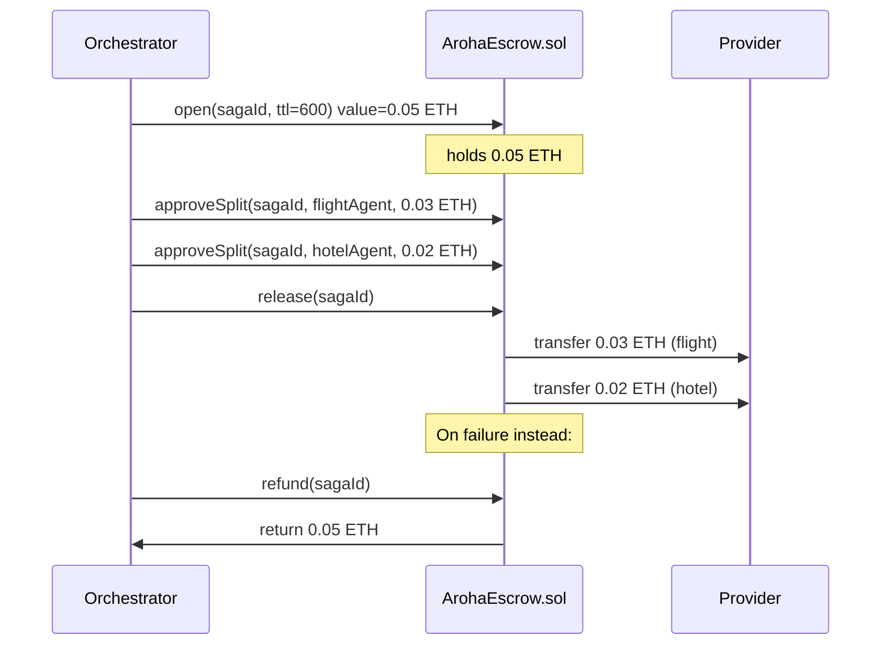

<!-- Copyright (c) 2026 Aroha Labs
     SPDX-License-Identifier: Apache-2.0 -->

# Smart Contracts

Three Solidity contracts implement Aroha's on-chain layer (optional — agents may use
the HTTP registry instead). The contracts are an optional extension, not part of the core
protocol ([positioning](../positioning.md)), and have not been independently audited.

**Language:** Solidity 0.8.24  
**Toolchain:** Foundry (`forge build`, `anvil`)  
**Networks:** Local Anvil (development), any EVM-compatible chain (production)

---

## Quick start

```bash
# Start local chain
anvil

# Deploy all three contracts
node scripts/setup-chain.mjs
# Writes contract addresses to chain-addresses.json

# Compile manually (optional)
forge build
```

---

## ArohaRegistry.sol

Agent registration and capability indexing. Agents stake ETH to register.

### Key functions

```solidity
// Register agent with minimum stake (0.001 ETH)
function register(
    bytes32 didHash,           // keccak256(abi.encodePacked(did))
    string calldata ipfsManifest,  // IPFS CID of capability manifest
    bytes calldata publicKey   // Ed25519 public key (32 bytes)
) external payable

// Index capabilities for discovery
function indexCapabilities(
    bytes32 didHash,
    bytes32[] calldata capabilityHashes  // keccak256 of capability IDs
) external

// Query agents by capability
function queryByCapability(bytes32 capHash)
    external view returns (bytes32[] memory didHashes)

// Resolve agent record
function resolve(bytes32 didHash)
    external view returns (AgentRecord memory)

// Deactivate (only owner)
function deactivate(bytes32 didHash) external

// Update manifest CID (only owner, stake preserved)
function updateManifest(bytes32 didHash, string calldata newCID) external

// Set the reputation oracle address (only contract owner)
function setReputationOracle(address oracle) external
```

### AgentRecord struct

```solidity
struct AgentRecord {
    bytes32 didHash;
    address owner;
    string  manifestCID;
    bytes   publicKey;      // Ed25519 32-byte public key
    uint256 stakedWei;
    uint32  reputationScore; // 0–10000
    bool    active;
    uint256 registeredAt;
    uint256 lastUpdatedAt;
}
```

### TypeScript client

```typescript
import { ArohaRegistryContract } from "@aroha-sdk/registry/contract";

const registry = new ArohaRegistryContract({
  rpcUrl: "http://127.0.0.1:8545",
  contractAddress: addresses.registry,
  signerPrivateKey: process.env.OPERATOR_PRIVATE_KEY!,
});

await registry.register(
  "did:aroha:my-agent",
  manifestCID,
  identity.publicKey,
  { stakeWei: BigInt("1000000000000000") }   // 0.001 ETH
);

const agents = await registry.queryByCapability(["book-flight"]);
```

---

## ArohaEscrow.sol

Atomic escrow per saga. Opened by the orchestrator; split-approved per provider;
released after all commits.

### Key functions

```solidity
// Open escrow for a saga (value = total payment budget)
function open(bytes32 sagaId, uint256 ttlSeconds) external payable

// Approve a payment split to a provider (called per saga step)
function approveSplit(
    bytes32 sagaId,
    address payable recipient,
    uint256 amount
) external

// Release all approved splits (called after all commits succeed)
function release(bytes32 sagaId) external

// Refund to orchestrator (called if saga fails/compensates)
function refund(bytes32 sagaId) external

// View escrow state
function getEscrow(bytes32 sagaId)
    external view returns (EscrowRecord memory)
```

### EscrowRecord struct

```solidity
struct EscrowRecord {
    address orchestrator;
    uint256 totalWei;
    uint256 releasedWei;
    uint256 expiresAt;
    bool    released;
    bool    refunded;
}
```

### Escrow flow



---

## ArohaReputation.sol

Outcome-based reputation scores. Written by the escrow oracle after each saga completes.
Uses an Exponential Moving Average (EMA): `score = α × outcome + (1 − α) × score`.

### Key functions

```solidity
// Record outcome (only callable by authorized oracle)
function recordOutcome(
    bytes32 sagaId,
    bytes32 agentDIDHash,
    uint8   outcome         // 0=dissatisfied, 1=neutral, 2=satisfied
) external

// Get current reputation score (0–10000)
function getScore(bytes32 agentDIDHash) external view returns (uint32)

// Get full reputation record
function getRecord(bytes32 agentDIDHash)
    external view returns (ReputationRecord memory)
```

### ReputationRecord struct

```solidity
struct ReputationRecord {
    uint32  score;          // 0–10000
    uint256 successCount;
    uint256 failureCount;
    uint256 lastUpdatedAt;
}
```

### Reputation REST proxy

No wallet needed to check reputation:

```bash
curl http://localhost:3002/api/v1/reputation/did:aroha:my-provider
```

```json
{
  "did": "did:aroha:my-provider",
  "score": 8742,
  "maxScore": 10000,
  "grade": "A",
  "successCount": 142,
  "failureCount": 3
}
```

---

## Deployment

```bash
# Local Anvil (auto-deploys all three contracts)
node scripts/setup-chain.mjs

# Foundry deploy script (alternative)
forge script script/Deploy.s.sol --rpc-url http://127.0.0.1:8545 --broadcast

# Production (replace with your RPC and private key)
PRIVATE_KEY=0x... RPC_URL=https://... forge script script/Deploy.s.sol --broadcast
```

Contract addresses are written to `chain-addresses.json` after deployment.
