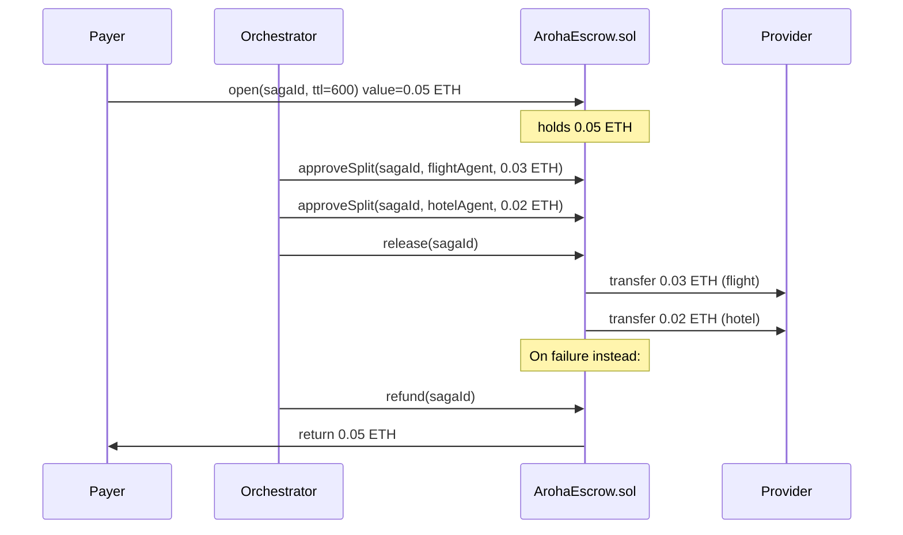

<!-- Copyright (c) 2026 Aroha Labs
     SPDX-License-Identifier: Apache-2.0 -->

# Smart Contracts

Three Solidity contracts implement Aroha's on-chain layer (optional — agents may use
the HTTP registry instead). The contracts are an optional extension, not part of the core
protocol ([positioning](../positioning.md)), and have not been independently audited.

**Language:** Solidity 0.8.24  
**Toolchain:** Foundry (`forge build`, `anvil`)  
**Networks:** Local Anvil (development), any EVM-compatible chain (production)

---

## Quick start

```bash
# Start local chain
anvil

# Deploy all three contracts
node scripts/setup-chain.mjs
# Writes contract addresses to chain-addresses.json

# Compile manually (optional)
forge build
```

---

## ArohaRegistry.sol

Agent registration and capability indexing. Agents stake ETH to register.

### Key functions

```solidity
// Register agent; msg.value must be at least minStakeWei (default 0.01 ETH)
function register(
    bytes32 didHash,           // keccak256(did)
    string calldata manifestCID,   // IPFS CID of capability manifest
    bytes calldata publicKey   // Ed25519 public key (32 bytes)
) external payable

// Index capabilities for discovery (only the agent's owner address)
function indexCapabilities(
    bytes32 didHash,
    bytes32[] calldata capabilityHashes  // keccak256 of capability IDs
) external

// Query active agents that declare at least one of the given capabilities
function queryByCapability(bytes32[] calldata capabilityHashes)
    external view returns (AgentRecord[] memory)

// Resolve agent record
function resolveByDID(bytes32 didHash)
    external view returns (AgentRecord memory)

// Deactivate and return the stake (only the agent's owner address)
function deactivate(bytes32 didHash) external

// Update manifest CID (only the agent's owner address, stake preserved)
function updateManifest(bytes32 didHash, string calldata newCID) external

// Rotate the public key (only the agent's owner address; the 64-byte
// rotationProof is not verified on-chain, it is emitted for off-chain checks)
function updatePublicKey(bytes32 didHash, bytes calldata newPublicKey, bytes calldata rotationProof) external

// Current minimum stake
function getMinStake() external view returns (uint256)

// Only the configured reputation oracle
function updateReputation(bytes32 didHash, uint32 newScore) external

// Only the configured dispute contract
function slashStake(bytes32 didHash, uint256 amount, string calldata reason) external

// Admin (only the contract owner)
function setMinStake(uint256 newMin) external
function setReputationOracle(address oracle) external
function setDisputeContract(address dispute) external
```

### AgentRecord struct

```solidity
struct AgentRecord {
    bytes32 didHash;
    address ownerAddress;
    string  manifestCID;
    bytes   publicKey;      // Ed25519 32-byte public key
    uint256 stakedWei;
    uint32  reputationScore; // 0–10000
    bool    active;
    uint256 registeredAt;
    uint256 lastUpdatedAt;
}
```

### TypeScript client

```typescript
import { ethers } from "ethers";
import { ArohaRegistryContract } from "@aroha-sdk/registry/contract";

const registry = new ArohaRegistryContract(
  "http://127.0.0.1:8545",              // rpcUrl
  addresses.registry,                   // contractAddress
  new ethers.Wallet(operatorPrivateKey) // optional signer, needed for writes
);

await registry.register(
  "did:aroha:my-agent",
  manifestCID,
  identity.publicKey,
  { stakeWei: ethers.parseEther("0.01") }   // omit to use the on-chain minimum
);

const agents = await registry.queryByCapability(["book-flight"]);
```

---

## ArohaEscrow.sol

Atomic escrow per saga. Opened by the payer; split-approved per provider by the
authorized orchestrator address (set in the constructor); released after all commits.

### Key functions

```solidity
// Open escrow for a saga (msg.value = total payment budget; the caller is the payer)
function open(bytes32 sagaId, uint256 ttlSeconds) external payable

// Approve a payment split to a provider (only the authorized orchestrator)
function approveSplit(
    bytes32 sagaId,
    address payable recipient,
    uint256 amount
) external

// Release all approved splits; any unallocated remainder goes back to the payer
// (only the authorized orchestrator)
function release(bytes32 sagaId) external

// Refund the full amount to the payer (only the authorized orchestrator)
function refund(bytes32 sagaId) external

// Refund the payer after the TTL has passed (callable by anyone)
function expireRefund(bytes32 sagaId) external

// View escrow state
function getEscrow(bytes32 sagaId)
    external view returns (EscrowRecord memory)
```

### EscrowRecord struct

```solidity
enum EscrowState { OPEN, RELEASED, REFUNDED }

struct EscrowRecord {
    bytes32     sagaId;
    address     payer;
    uint256     totalAmount;
    uint256     releasedAmount;
    EscrowState state;
    uint256     createdAt;
    uint256     expiresAt;
}
```

### Escrow flow



---

## ArohaReputation.sol

Outcome-based reputation scores, recorded per saga step. Each outcome updates an
Exponential Moving Average: `score = 0.85 × score + 0.15 × signal` (scores 0–10000,
5000 = neutral starting score), and the new score is written to `ArohaRegistry` through
`updateReputation`. The signal is 10000 for `SUCCESS`, 3000 for `COMPENSATED`, 1000 for
`FAILURE` and 0 for `DISPUTE_LOST`; a rated `SUCCESS` blends 60% execution signal with
40% quality (`qualityStars × 2000`).

### Key functions

```solidity
enum SagaOutcome { SUCCESS, FAILURE, COMPENSATED, DISPUTE_LOST }

// Record the outcome of a saga step for one agent (one record per sagaId per agent).
// Only the contract owner (the deploying address); other callers revert with Unauthorized()
function recordOutcome(
    bytes32 sagaId,
    bytes32 agentDID,          // DID hash
    SagaOutcome outcome,
    uint8   qualityStars       // 0 = unrated, 1–5; applied only to SUCCESS
) external

// Get current reputation score (0–10000; 5000 if no outcome recorded)
function getScore(bytes32 agentDID) external view returns (uint32)

// Get the stored outcome records (the most recent 1000)
function getOutcomes(bytes32 agentDID)
    external view returns (OutcomeRecord[] memory)
```

### OutcomeRecord struct

```solidity
struct OutcomeRecord {
    bytes32     sagaId;
    bytes32     agentDID;
    SagaOutcome outcome;
    uint8       qualityStars;  // 0 = unrated, 1–5
    uint256     recordedAt;
}
```

### Reputation REST sidecar (mock provider)

The example `agents/mock-provider-agent` runs an unauthenticated development sidecar on
port 3002 (`REP_PORT`). It returns a **simulated** score derived from the DID string; it
does not read `ArohaReputation.sol`:

```bash
curl http://localhost:3002/api/v1/reputation/did:aroha:my-provider
```

```json
{
  "did": "did:aroha:my-provider",
  "score": 8742,
  "maxScore": 10000,
  "grade": "B",
  "successCount": 145,
  "failureCount": 2,
  "lastUpdated": 1767225600000,
  "source": "ArohaReputation.sol (simulated — connect Anvil for live data)"
}
```

---

## Deployment

```bash
# Local Anvil (auto-deploys all three contracts)
node scripts/setup-chain.mjs

# Foundry deploy script (alternative, local Anvil)
forge build
forge script script/Deploy.s.sol --rpc-url http://127.0.0.1:8545 \
  --private-key <Anvil account #0 private key> --broadcast
```

`script/Deploy.s.sol` is written for local Anvil deployment and reads no environment
variables. It deploys the registry, escrow (with the deploying account as the authorized
orchestrator) and reputation contracts from the `--private-key` account, wires the
reputation oracle into the registry, and logs the three addresses; forge also records
them under `broadcast/Deploy.s.sol/`. Without `--broadcast` it only simulates. It does
not write `chain-addresses.json`.

`setup-chain.mjs` writes the contract addresses to `chain-addresses.json` after deployment.
