<!-- Copyright (c) 2026 Aroha Labs
     SPDX-License-Identifier: Apache-2.0 -->

# Packages

> **Positioning note (2026-10-19).** This page lists every package. Aroha now describes itself as the protocol for **bounded, verifiable agent authority** — who is acting, what a person allowed, how to stop it, and what happened. Discovery, sagas, settlement and commerce remain available as optional extensions and are documented here as such. See [What Aroha is (and is not)](../positioning.md), whose repository map groups packages into core, adapters, tooling and extensions.

Aroha ships as independently installable npm packages organised into two tiers: a **protocol kernel** that is always required, and **opt-in extensions** that add capabilities without coupling the core to any specific billing, commerce, or credential model.

## Protocol Kernel

The kernel covers the three things every Aroha agent needs: a verifiable identity, a way to be discovered, and a way to send authenticated messages.

```
@aroha-sdk/core           Transport, identity, crypto, signed messaging
@aroha-sdk/registry       Registry clients, IPFS manifests, discovery
```

## Protocol Extensions

Extensions are fully optional. Mount them via middleware or inject them into the saga engine — the kernel never imports them.

```
@aroha-sdk/credentials    RBAC middleware, human credential issuance + verification
@aroha-sdk/settlement     Pluggable billing: NullSettlement, ApiKey, Quota, EscrowSettlement
@aroha-sdk/commerce       B2B contracts + SLA · B2C subscriptions + GDPR consent · C2B quality signals
@aroha-sdk/orchestrator   Saga engine, agent selection (fan-out), negotiation
@aroha-sdk/preferences    Preference profiles, budget constraints, satisfaction signals
```

## Protocol Bridges

Wrap existing agents from other protocols — your current code keeps running, the bridge speaks Aroha.

```
@aroha-sdk/mcp-bridge          MCP ↔ Aroha (tools become capabilities)
@aroha-sdk/a2a-bridge          A2A ↔ Aroha (tasks become saga steps)
@aroha-sdk/langchain-bridge    LangChain / OpenAI function tools ↔ Aroha (BYOF — no hard dep)
@aroha-sdk/hermes-bridge       Hermes Agent + ZeroClaw ↔ Aroha via stdio MCP
@aroha-sdk/openclaw-bridge     OpenClaw skills ↔ Aroha capabilities (bidirectional)
@aroha-sdk/composio-bridge     Composio / TrustClaw actions ↔ Aroha capabilities
```

## Agent Lifecycle

```
@aroha-sdk/run      HTTP server with streaming SSE, HITL approval gates, and session memory
@aroha-sdk/micro    Lightweight single-file agent scaffolding — .on() + .start()
@aroha-sdk/evals    LLM-as-judge evaluation framework; posts scores to reputation
@aroha-sdk/audit    Tamper-evident SHA-256 hash-chained append-only audit log
```

## Enterprise Tooling

```
@aroha-sdk/telemetry      W3C Trace Context (traceparent) — Datadog / Jaeger / Grafana Tempo
@aroha-sdk/trusted-mesh   VPC / mTLS mesh bypass — skip Ed25519 on internal networks
@aroha-sdk/cache          Semantic caching — content-addressed ArohaRequest deduplication (InMemory + Redis)
@aroha-sdk/policy         Policy-as-Code — deterministic JSON enforcement before LLM sees any request
@aroha-sdk/cli            Scaffold new agents; convert from A2A, MCP, LangChain, Agntcy; create-bridge
```

## Testing & Reliability

```
@aroha-sdk/resilience    Circuit breakers, bulkheads, retry, health checks, speculative execution
@aroha-sdk/chaos         Fault injection for sagas — verify LIFO compensation and circuit breaker trips
```

## Ecosystem Packages (community-built)

Pre-built proxy agents that wrap popular SaaS APIs:

```
@aroha-sdk/stripe-agent        Payments, customers, invoices — saga-capable
@aroha-sdk/salesforce-agent    Leads, accounts, opportunities — saga-capable
@aroha-sdk/zendesk-agent       Tickets, users, organizations — saga-capable
@aroha-sdk/github-agent        Issues, PRs, merge operations — saga-capable
@aroha-sdk/jira-agent          Issues, transitions, assignments — saga-capable
```

[See all community bridges and agents →](../ecosystem.md)

---

## Dependency graph

```mermaid
graph TD
    CLI["@aroha-sdk/cli"]
    PREF["@aroha-sdk/preferences"]
    ORCH["@aroha-sdk/orchestrator"]
    REG["@aroha-sdk/registry"]
    A2A["@aroha-sdk/a2a-bridge"]
    MCP["@aroha-sdk/mcp-bridge"]
    LC["@aroha-sdk/langchain-bridge"]
    HERMES["@aroha-sdk/hermes-bridge"]
    OC["@aroha-sdk/openclaw-bridge"]
    COMP["@aroha-sdk/composio-bridge"]
    CORE["@aroha-sdk/core"]
    CRED["@aroha-sdk/credentials"]
    SETT["@aroha-sdk/settlement"]
    COMM["@aroha-sdk/commerce"]
    TEL["@aroha-sdk/telemetry"]
    MESH["@aroha-sdk/trusted-mesh"]
    CACHE["@aroha-sdk/cache"]
    POL["@aroha-sdk/policy"]
    RUN["@aroha-sdk/run"]
    MICRO["@aroha-sdk/micro"]
    EVALS["@aroha-sdk/evals"]
    AUDIT["@aroha-sdk/audit"]
    RES["@aroha-sdk/resilience"]
    CHAOS["@aroha-sdk/chaos"]

    CLI --> CORE
    CLI --> REG
    PREF --> CORE
    PREF --> REG
    PREF --> ORCH
    ORCH --> CORE
    ORCH --> REG
    ORCH --> SETT
    REG --> CORE
    A2A --> CORE
    MCP --> CORE
    MCP --> REG
    LC --> CORE
    HERMES --> CORE
    OC --> CORE
    COMP --> CORE
    CRED --> CORE
    COMM --> CORE
    COMM --> SETT
    TEL --> CORE
    MESH --> CORE
    CACHE --> CORE
    POL --> CORE
    RUN --> CORE
    MICRO --> CORE
    EVALS --> CORE
    CHAOS --> CORE
    RES --> CORE
```



The arrow means "depends on". Notice that `@aroha-sdk/core` has no arrows pointing away from it to extensions — the kernel is clean and extension-free.

---

## Quick install

**Minimal provider agent (kernel only):**

```bash
npm install @aroha-sdk/core @aroha-sdk/registry
```

**Provider with RBAC:**

```bash
npm install @aroha-sdk/core @aroha-sdk/registry @aroha-sdk/credentials
```

**Orchestrator agent:**

```bash
npm install @aroha-sdk/core @aroha-sdk/registry @aroha-sdk/orchestrator @aroha-sdk/preferences
```

**Orchestrator with escrow settlement:**

```bash
npm install @aroha-sdk/core @aroha-sdk/registry @aroha-sdk/orchestrator @aroha-sdk/settlement
```

**Enterprise agent with B2B contracts:**

```bash
npm install @aroha-sdk/core @aroha-sdk/registry @aroha-sdk/orchestrator @aroha-sdk/settlement @aroha-sdk/commerce @aroha-sdk/credentials
```

**Protocol bridge (wrap existing MCP server):**

```bash
npm install @aroha-sdk/mcp-bridge
```

---

## Commerce patterns (`@aroha-sdk/commerce`)

The commerce package covers all three principal agent relationship types:

| Pattern | Parties | Key types | Settlement |
|---------|---------|-----------|------------|
| **B2B** | Org DID ↔ Org DID | `B2BAgreement`, `B2BSession`, `SlaMonitor` | `B2BBillingSettlement` — per-call, tiered, or flat-rate; period invoicing |
| **B2C** | Org DID → Personal DID | `B2CServiceTerms`, `ConsentRecord`, `B2CSubscription` | `B2CBillingSettlement` — quota + subscription charge, GDPR consent |
| **C2B** | Personal DID → Org DID | `C2BDataSubmission`, `C2BFeedback`, `C2BReputationSignal` | No settlement — quality signals feed `ArohaReputation.sol` |

All interactions are recorded in a `CommerceAuditLog` — a SHA-256 hash-chained, Ed25519-signed tamper-evident trail that can serve as evidence for GDPR records, SOC 2 controls and SLA disputes (self-assessed; not auditor-reviewed).

[Full @aroha-sdk/commerce reference →](commerce.md){ .md-button }
