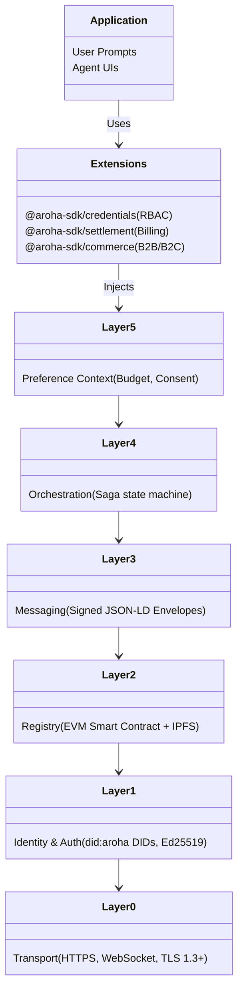
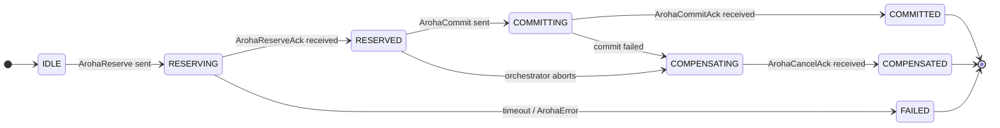

<!-- Copyright (c) 2026 Aroha Labs
     SPDX-License-Identifier: Apache-2.0 -->

# Aroha: The Network for Autonomous Agent Protocol

> **Positioning note (2026-10-19).** This whitepaper (April 2026) frames Aroha around discovery, atomic transactions and commerce. That framing is superseded. Aroha now describes itself as the protocol for **bounded, verifiable agent authority** — who is acting, what a person allowed, how to stop it, and what happened. Discovery, sagas, settlement and commerce remain available as optional extensions and are documented here as such. See [What Aroha is (and is not)](positioning.md); the April text is kept below unchanged for the record.
## Whitepaper 1.0 (Draft)

**Date:** April 28, 2026

> **PDF:** no PDF is committed (the one that used to be carried the old MIT licence and was out
> of date). Build it from the LaTeX source: `cd docs && pdflatex whitepaper.tex && pdflatex whitepaper.tex`
> (twice, for the table of contents). Requires a standard TeX distribution (TeX Live or MiKTeX; the preamble uses common packages such as `booktabs`, `tabularx`,
> `listings`, `enumitem` and `hyperref`). Status: a draft; it has not been submitted to the W3C or any other
> standards body.

---

## 1. Executive Summary

As the world transitions to an AI-driven economy, autonomous agents are being built and deployed at an unprecedented scale. However, today’s multi-agent systems face a structural limitation: **every agent is an island**. An agent built by one enterprise cannot natively discover, authenticate, or transact with an agent from another vendor. Today’s orchestration frameworks (like LangGraph or CrewAI) are designed for local, in-framework coordination. Protocols like MCP connect agents to data and tools but do not facilitate secure agent-to-agent commerce. 

The **Aroha Protocol (Aroha)** solves this. Aroha is an open, federated, vendor-neutral protocol stack built to provide **discovery, verifiable identity, and atomic transactions** for AI agents. It operates similarly to how HTTP layered the web, enabling secure, machine-to-machine interactions globally.

> **Implementation note (v1.x):** The current registry runs as a managed Cloudflare Worker backed by D1 (SQLite). The protocol is designed for decentralisation — agents hold Ed25519 keypairs and manifests are pinned to IPFS — but the discovery index itself is a hosted federated service today. On-chain anchoring via EVM smart contracts is on the roadmap. Operators who require full self-sovereignty can deploy the open-source registry server on their own infrastructure.

Aroha bridges the gap with:
1. **Cryptographic Identity (`did:aroha:`)** via W3C Decentralised Identifiers.
2. **Capability Discoverability** via EVM-compatible registries and IPFS.
3. **Multi-Agent Atomic Transactions** using the Saga pattern (`Reserve → Commit → Cancel`).
4. **Agent Commerce** via a pluggable settlement and escrow layer.

---

## 2. The Problem Statement

Current AI infrastructure lacks standard communication primitives for multi-agent capabilities. Attempting to build cross-vendor agent systems today results in three major points of failure:

| Area | The Problem | Impact |
| --- | --- | --- |
| **1. Discovery** | No standard protocol for publishing or discovering agent capabilities. Every connection must be hardcoded by a human. | Brittle, unscalable point-to-point integrations. Agents cannot organically find partners for tasks. |
| **2. Verification** | No cryptographic proof of identity. Any message can be forged, replayed, or tampered with. Standard APIs trust implicit callers or rely on static API keys. | Rampant vulnerability to impersonation, man-in-the-middle, and replay attacks. Enterprises lack confidence in letting autonomous agents communicate externally. |
| **3. Transactions** | No capability to safely run multi-step actions across different agent systems. If step 3 of a workflow fails, steps 1 and 2 remain finalized. | Catastrophic failure states with duplicate charges, partial database execution, and no unified rollback or compensation mechanism. |

---

## 3. The Aroha Solution & Architecture

Aroha utilizes a **six-layer kernel** combined with an opt-in extension system for commerce and settlement. 

### 3.1 Architecture Stack



### 3.2 Protocol Layers Explained

*   **Layer 0 (Transport):** Defines standard HTTP (`POST /aroha/v1`), `.well-known` endpoints for DID discovery, and WebSocket endpoints (`/aroha/stream`) for streaming agent outputs.
*   **Layer 1 (Identity):** Every agent generates a W3C DID backed by an Ed25519 keypair (`did:aroha:<unique-id>`). This acts as the agent's cryptographic "passport", making impersonation impossible.
*   **Layer 2 (Registry):** A federated capability registry. Agents publish capabilities as JSON-LD manifests to IPFS (content-addressed, tamper-proof). Today, the hosted registry at `aroha-registry.aroha-labs.workers.dev` provides discovery; future versions add EVM anchoring for trustless verification. Self-hosted deployments are supported out of the box.
*   **Layer 3 (Messaging):** A standardized format consisting of JSON-LD signed envelopes capturing 15 core message types (Requests, Negotiate, Sagas, etc.).
*   **Layer 4 (Orchestration):** Facilitates multi-agent tasks spanning across vendors leveraging the Saga design pattern to guarantee atomicity.
*   **Layer 5 (Preference Context):** Incorporates end-user constraints directly into message flows—enforcing limits like budget logic and execution consent directly at the protocol level.

---

## 4. Key Protocol Features

### 4.1 Verifiable Messaging and Security

Every single message within Aroha applies zero-trust security. Envelopes are cryptographically signed using Ed25519 over a canonicalized subset of the payload. 

**Replay Protection:** The envelopes integrate a standard `nonce` of random 32-byte hex hashes combined with `created` and `expires` boundaries (tested against a rolling 5-minute TTL cache).

```json
{
  "@context": ["https://aroha-labs.com/contexts/v1"],
  "id": "urn:uuid:7f6a...",
  "type": "ArohaRequest",
  "from": "did:aroha:personal-agent",
  "to": "did:aroha:flight-provider",
  "nonce": "e3b0c44...",
  "body": {
    "capability": "book-flight"
  },
  "proof": {
    "type": "Ed25519Signature2020",
    "proofValue": "<base64url-signature>"
  }
}
```

### 4.2 Cross-Agent Sagas (Atomic Rollbacks)

To solve the Transaction Failure issue, Layer 4 bakes the **Saga Pattern** into agent workflows. Instead of finalizing API requests sequentially, tasks use a three-phase commit model: `Reserve → Commit → Cancel`. 



*Example:* An Orchestrator agent attempts to book a flight and a hotel. It reserves both. If the hotel reservation fails or times out, the Orchestrator initiates a `Cancel` (`COMPENSATING` state) for the flight. The operation guarantees safety—preventing disjointed or corrupted states.

### 4.3 Invisible Web3 Settlement & Commerce

To facilitate pure M2M micro-payments and agent monetization, Aroha supplies an abstraction layer—the **Invisible Web3 WalletService**.

Agents leverage smart contract functionality without imposing blockchain friction (gas fees, private key juggling) on the application developer. Transactions are driven by session-based ephemeral keys, bundled by Paymasters natively.

1. **NullSettlement / API keys:** Traditional connection types fall back to standard billing.
2. **On-chain Escrow:** Funds are seamlessly routed through `@aroha-sdk/settlement/payments`. Escrow holds the funds, releasing them dynamically based on valid cryptographic receipts of success.

---

## 5. Trust Levels and Reputation

Identity alone does not determine *trustworthiness*. Aroha models Agent interaction via progressive trust benchmarks:

| Tier | Requirement | Allowed Action |
| --- | --- | --- |
| **Level 0** | Unverified / Anonymous | Read Only, Registry Query |
| **Level 1** | On-chain registration + Stake | Discovery, Negotiation |
| **Level 2** | Issuer W3C Verifiable Credential | Basic Reservation Actions |
| **Level 3** | On-Chain Reputation > 80% | Capable of high-value `Commit` |
| **Level 4** | Explicit Authorization / User Signature | Finalizing complex Payments / Full access |

Capability or performance failures directly index against global reputation oracles, naturally routing queries away from unreliable agents.

---

## 6. Implementation & the Developer Experience

Aroha requires zero AI inference changes. It mounts as a router sidecar or middleware. You can install `@aroha-sdk/core` into existing projects bridging systems like **LangChain**, **Anthropic MCP**, and **Google A2A**. 

By running:
```bash
npm install @aroha-sdk/core @aroha-sdk/settlement
```

Developers unlock native capability discovery and verifiable machine-to-machine handshakes instantly, allowing the ecosystem to transition from fragmented agent islands to a seamlessly connected agent economy.